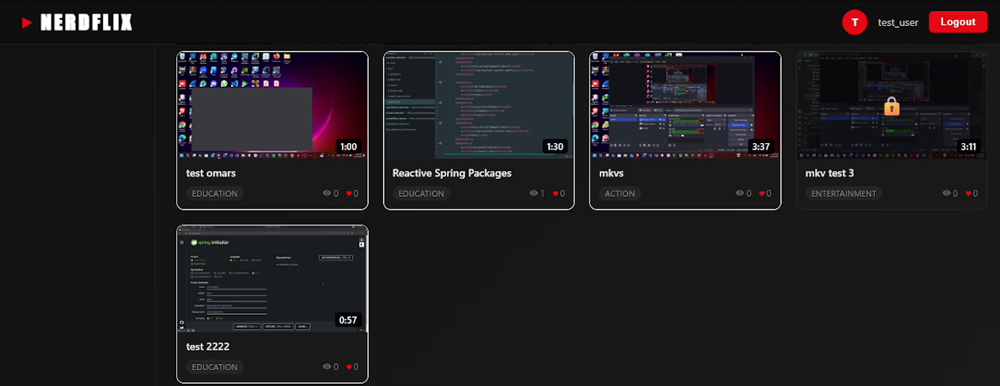
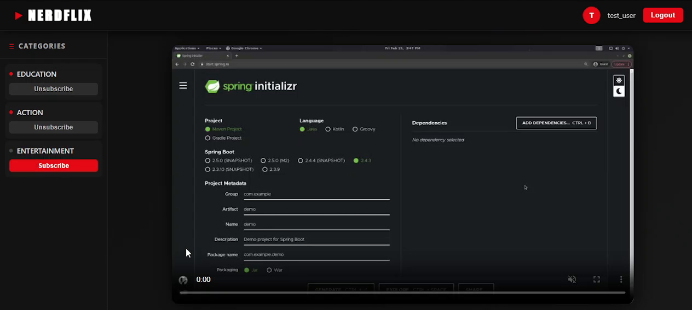
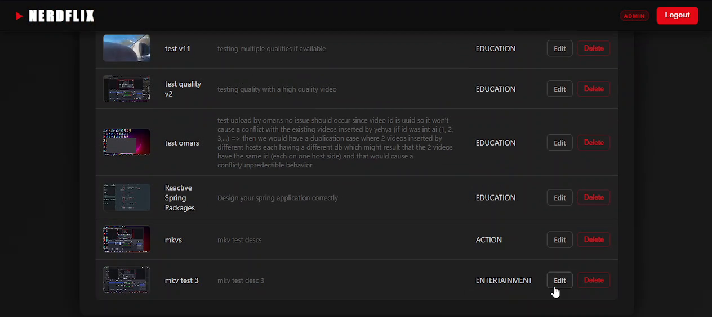
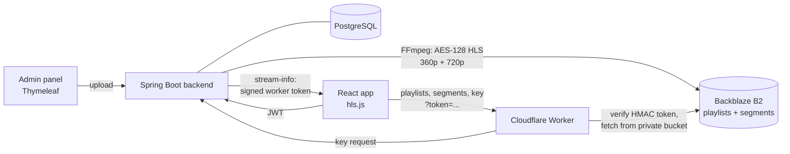

# Nerdflix

A video streaming platform where videos are only playable by signed-in subscribers. Videos are encrypted with AES-128, served through a Cloudflare Worker with short-lived signed URLs, and the decryption key is released only after the backend checks the viewer's subscription.

## What it does

- **Viewers** register, sign in, subscribe to categories, and watch, like and track videos in a React app with adaptive quality (360p and 720p).
- **Admins** upload, edit and delete videos from a Thymeleaf admin panel. Each upload is transcoded in the background and published automatically.

## Screenshots

**Catalog.** Videos in categories the viewer hasn't subscribed to are locked.



**Player.** HLS playback with hls.js, quality selection and likes.



**Admin panel.** Upload, edit and delete videos.



## Architecture



## How the content is protected

1. **Encryption at upload.** FFmpeg packages each upload as AES-128 encrypted HLS in two renditions plus a master playlist. Only playlists and segments are uploaded to the bucket. The key file never leaves the server.
2. **Signed, short-lived access.** Before playback the app calls `/api/videos/{id}/stream-info`. The backend checks that the user is subscribed to the video's category and returns a manifest URL with an HMAC-SHA256 token bound to that user and video, valid for 30 minutes.
3. **Edge verification.** The Cloudflare Worker verifies the token on every request, fetches files from the private B2 bucket with a cached B2 authorization, and rewrites each playlist so every segment and key URI carries the token.
4. **Gated key delivery.** Key requests go through the Worker to `/api/license`, which verifies the token again, re-checks the subscription, and returns the key with `Cache-Control: no-store`.

## Security design

- Two Spring Security filter chains:
  - **Admin panel:** session-based form login with CSRF protection, `ROLE_ADMIN` only.
  - **API:** stateless, with JWT authentication.
- **Tokens:** JWT access tokens last 15 minutes. Refresh tokens are stored in the database, last 7 days and can be revoked through `/auth/logout`.
- **Passwords:** hashed with BCrypt.
- **Authorization:** method-level checks with `@EnableMethodSecurity`, and subscription checks on the stream-info and license endpoints.
- **Secrets:** all of them are read from environment variables. None are stored in the repository.

## Tech stack

| Part | Technologies |
| --- | --- |
| Backend | Java 22, Spring Boot 4, Spring Security, Spring Data JPA, PostgreSQL, JJWT, MapStruct, Thymeleaf, AWS SDK v2 (S3 API) |
| Video pipeline | FFmpeg (HLS, AES-128, thumbnails) |
| Storage and edge | Backblaze B2, Cloudflare Workers |
| Frontend | React 19, Redux Toolkit, React Router, hls.js, Bootstrap, Vite |

## Project structure

```
nerdflix-spring-boot/   Spring Boot backend and admin panel
nerdflix-react/         React viewer app
local-worker/           Cloudflare Worker (stream proxy and key relay)
```

## Running locally

Prerequisites: Java 22, Node.js 20+, PostgreSQL, FFmpeg on the PATH, a Backblaze B2 bucket, and the Wrangler CLI.

1. **Backend:** copy `nerdflix-spring-boot/.env.example` to `.env`, fill in the values, load them into your environment, then run:
   ```
   cd nerdflix-spring-boot
   ./mvnw spring-boot:run
   ```
   The API runs on `http://localhost:8080` and the admin panel on `http://localhost:8080/login`.
2. **Worker:** copy `local-worker/.dev.vars.example` to `.dev.vars`, fill in the values (`WORKER_TOKEN_SECRET` must match the backend), then run:
   ```
   cd local-worker
   npx wrangler dev
   ```
   The Worker runs on `http://localhost:8787`.
3. **Frontend:**
   ```
   cd nerdflix-react
   npm install
   npm run dev
   ```

## Author

Mohammad Omar Allaham · [LinkedIn](https://www.linkedin.com/in/mohammad-omar-al-laham/) · [GitHub](https://github.com/Omarallaham58)
